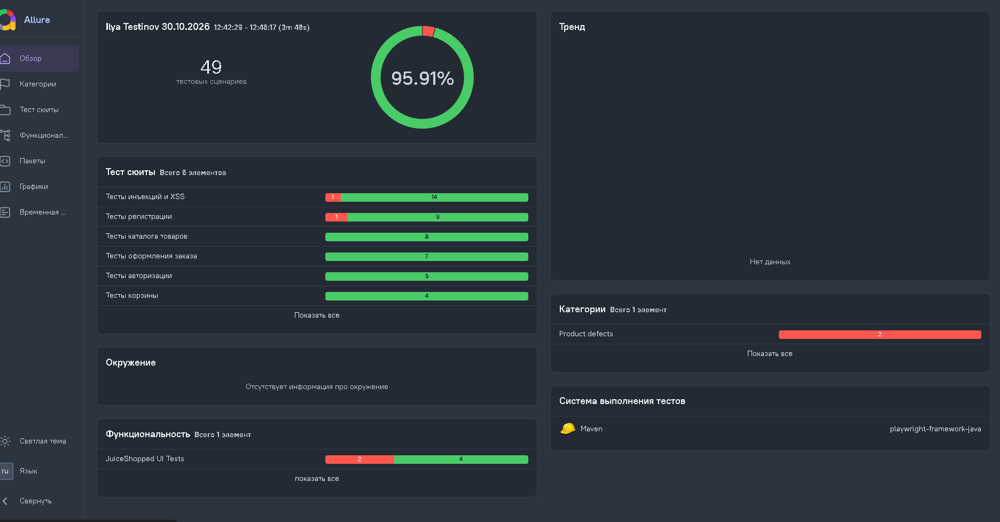
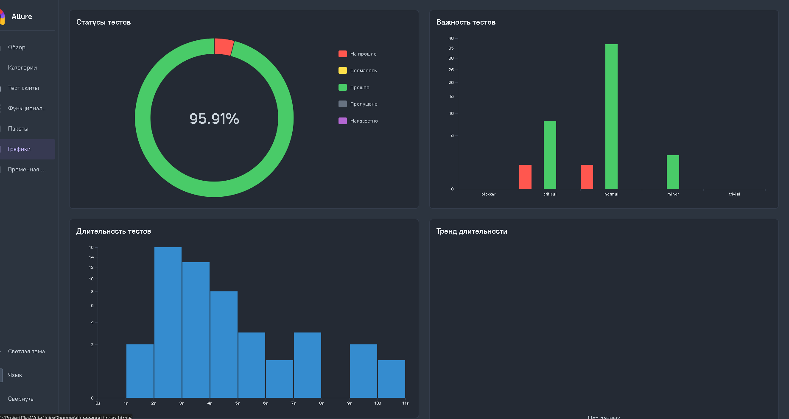

markdown
# 🛡️ Security Automation Portfolio — OWASP Juice Shop

Автоматизированные тесты на уязвимости веб-приложения [OWASP Juice Shop](https://owasp.org/www-project-juice-shop/) на **Java + Playwright + JUnit 5 + Allure**.

Проект демонстрирует навыки **security-тестирования** (OWASP Top 10) и построения **Page Object-фреймворка** с отчётностью.

---

## 📊 Что покрыто (49 тестов из них 15 проверка на уязвимости приложения)

### Security-тесты (15)
| ID | Уязвимость | CWE | Категория |
|----|------------|-----|-----------|
| SEC-01 | SQL Injection в логине (blind) | CWE-89 | Injection |
| SEC-02 | SQL Injection в логине (targeted admin) | CWE-89 | Injection |
| SEC-03 | Reflected XSS в поиске | CWE-79 | XSS |
| SEC-04 | DOM XSS через URL | CWE-79 | XSS |
| SEC-05 | IDOR в API корзины | CWE-639 | Broken Access Control |
| SEC-06 | Chain: SQLi → Admin Panel | CWE-89 + CWE-285 | Broken Access Control |
| SEC-07 | API-only XSS (PUT /api/Products) | CWE-79 | XSS |
| SEC-08 | Сброс пароля Jim через security question | CWE-640 | Broken Authentication |
| SEC-09 | Forged Review (подделка отзыва) | CWE-639 | Broken Access Control |
| SEC-10 | Unsigned JWT (alg:none) | CWE-347 | Broken Authentication |
| SEC-11 | Product Tampering | CWE-639 | Broken Access Control |
| SEC-12 | Admin Panel защита (negative test) | CWE-285 | Broken Access Control |
| SEC-13 | SQLi: извлечение схемы БД | CWE-89 | Injection |
| SEC-14 | SQLi: извлечение учётных данных | CWE-89 | Injection |
| SEC-15 | SQLi: Ephemeral Accountant | CWE-89 | Injection |

---

## 🛠️ Стек

- **Java 22**
- **Playwright** (Java) — UI-автоматизация + API через `fetch`
- **JUnit 5** — тест-раннер, `@TestMethodOrder`, `@Order`
- **Allure** — отчётность (Epic/Feature/Story, attachments, screenshots)
- **Maven** — сборка
- **Gson** — парсинг JSON
- **Docker** — развёртывание Juice Shop локально
- **Postman** — ручная проверка API

---



## 🚀 Как запустить

### 1. Развернуть Juice Shop (Docker)

```bash
docker run -d --name juice-shop -p 3000:3000 bkimminich/juice-shop
Приложение будет доступно: http://localhost:3000

2. Настроить test.properties
В src/test/resources/test.properties:

properties
browser.headless=false
browser.type=chromium
browser.timeout=30000
base.url=http://localhost:3000
3. Запустить тесты
bash
mvn clean test
4. Сгенерировать Allure-отчёт
bash
mvn allure:report
Отчёт откроется в target/allure-report/index.html.

Или single-file версия:

bash
allure generate target/allure-results --single-file -o target/allure-report
Готовый отчёт: target/allure-report/index.html (можно переименовать в Security_Test_Allure_Report.html).

📁 Структура проекта
text
playwright-framework-java/
├── src/
│   ├── main/java/
│   │   ├── base/
│   │   │   └── BaseTest.java              # @BeforeEach/@AfterEach, скриншот при падении
│   │   ├── config/
│   │   │   └── TestConfig.java            # чтение test.properties
│   │   ├── pages/
│   │   │   ├── RegisterPage.java          # регистрация (RG-01…RG-10)
│   │   │   ├── LoginPage.java             # логин (LG-01…LG-05)
│   │   │   ├── InventoryPage.java         # товары (INV-01…INV-06)
│   │   │   ├── CartPage.java              # корзина
│   │   │   ├── SecurityPage.java          # security-тесты (SEC-01…SEC-12)
│   │   │   └── XssPage.java               # XSS-тесты (Reflected, DOM)
│   │   └── utils/
│   │       └── ScreenshotsSelective.java  # скриншоты в Allure
│   └── test/
│       ├── java/tests/
│       │   ├── RegisterTest.java
│       │   ├── LoginTest.java
│       │   ├── InventoryTest.java
│       │   └── SecurityTest.java          # 12 security-тестов
│       └── resources/
│           ├── test.properties
│           └── junit-platform.properties  # порядок классов
├── pom.xml
└── README.md
🎯 Ключевые технические решения
1. Порядок выполнения тестов
Классы: @Order(1) на RegisterTest, @Order(2) на LoginTest и т.д. + junit-platform.properties:

properties
junit.jupiter.testclass.order.default = org.junit.jupiter.api.ClassOrderer$OrderAnnotation
Методы: @TestMethodOrder(MethodOrderer.OrderAnnotation.class) + @Order(1), @Order(2).

2. Allure-отчётность
Группировка по Epic → Feature → Story (@Epic("Security Tests"), @Feature("Injection"), @Story("SQL Injection")).

Attachments: JSON-ответы IDOR/JWT, скриншоты «до/после» Product Tampering.

ScreenshotOnFailure — JUnit 5 extension, автоматический скриншот при падении.

3. Работа с API через fetch
Для IDOR, Product Tampering, JWT-формирования использован page.evaluate(fetch) в контексте браузера — токен подхватывается из localStorage автоматически.

java
Object response = page.evaluate(
    "async (id) => { " +
    "  const token = localStorage.getItem('token'); " +
    "  const res = await fetch('/rest/basket/' + id, { " +
    "    headers: { 'Authorization': 'Bearer ' + token } " +
    "  }); " +
    "  return { status: res.status, body: await res.text() }; " +
    "}",
    basketId
);
4. Трассировка Playwright
Для отладки включена запись трассировки:

java
context.tracing().start(new Tracing.StartOptions()
    .setScreenshots(true)
    .setSnapshots(true)
    .setSources(true));
Открыть: npx playwright show-trace target/traces/trace-*.zip или trace.playwright.dev.

📈 Allure-отчёт
После прогона тестов открывается отчёт с:

Overview — общая статистика (14 — security тестов, passed).

Behaviors — группировка по CWE (Injection, XSS, Broken Access Control, Broken Authentication).

Suites — по классам (SecurityTest, RegisterTest, …).

Attachments — JSON-ответы IDOR, JWT, скриншоты.
